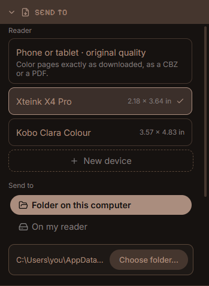

<div align="center">


# MangaPoint

**The easiest way to get manga onto your e-reader.**<br>Search, download, crop and convert in one app, then send it to your device.

[](https://github.com/W1seGit/MangaPoint/actions/workflows/ci.yml)
[](https://github.com/W1seGit/MangaPoint/releases/latest)
[](LICENSE)


[Download](https://github.com/W1seGit/MangaPoint/releases/latest) ·
[Features](#features) ·
[Getting started](#getting-started) ·
[Build from source](#build-from-source) ·
[Contributing](CONTRIBUTING.md)


</div>

---

Getting manga onto an e-ink reader used to mean a long chain of chores: find a
site to download from, save hundreds of page images, crop the margins, resize
them for your screen, convert them to a format your reader opens, and copy the
result over. MangaPoint does all of it for you, in one app:

|  | Before | With MangaPoint |
|---|---|---|
| Finding it | Hunt for a site, one title at a time | Search many sources at once |
| Getting it | Save page images by hand, or run a script | Pick chapters, press download |
| Making it fit | Crop, resize and convert in other tools | Done for your reader's own screen, with a live preview |
| Sending it | Work out the format, then copy files around | Export to a folder, USB drive, SD card or Wi-Fi |

It was built for the Xteink readers (X4, X4 Pro, X3), and it also makes
standard EPUB files for Kindle, Kobo, Boox, PocketBook and reMarkable, and CBZ comic archives for the readers that open them.
Everything runs on your computer. There is no account and no server of ours.

## Features

### Search many sources at once

Type a title and every source you installed is asked at the same time. The same
series from several sources is grouped into one card, with how many chapters it
has, and the best source for each is picked by looking at its chapter list.
Covers, descriptions and details come from whichever source answers first.

<div align="center">

</div>

### Pick chapters, and download them

Open a series to see every chapter from all its sources merged into one list,
with the sources that have each one and any gaps flagged. Filter, sort, or type a
range like `1-20, 25, 30-`, then add them to the downloads. If a page fails,
another source is tried.

<div align="center">

</div>

### A download queue that keeps going

Downloads run one series after another with pause, resume, retry and reordering,
and pick up where they stopped if you close the app. A notification tells you
when something finishes. Your library lists what you have, with sizes, and lets
you delete a series or only some of its chapters.

<div align="center">

</div>

### Convert for your reader's own screen

Pages are made at your reader's exact size and density, so nothing is scaled
again on the device. Automatic or manual cropping, double-page spreads, long
strips cut into screen-sized slices, contrast and dithering are all there, and so
is **Landscape** for a reader held sideways (turn it counter-clockwise for XTC and
XTCH; EPUB and CBZ get wide pictures) and a **Zoom** (Fit, or 100–300%) that
either cuts a zoomed page into screens in reading order or keeps its middle,
with a live preview that shows the source next to the result. Start from a preset
(Manga, Manhwa, Manhua) or keep your own.

<div align="center">

</div>

### Send it where it needs to go

Choose a format, how many files, and where to put them: a folder, a USB drive or
SD card (found automatically, with a "Safe to unplug" message), or Wi-Fi.

| | |
|---|---|
| **XTC**: black and white; the smallest files and the quickest to open | **XTCH**: four grays; twice the size |
| **EPUB**: a fixed-layout EPUB 3 that nearly every reader opens, with the chapters as its table of contents | **CBZ**: a comic archive with a `ComicInfo.xml` (series, author, summary, genres, reading direction) and the chapters as page bookmarks |
| **One file** per series, per chapter, or every N chapters; long EPUBs are cut into parts | |

<div align="center">

</div>

### Your reader, set up once

A catalog of 29 readers from Xteink, Amazon, Kobo, Boox, PocketBook and reMarkable
comes with their screen sizes, densities and file formats; add your own by typing
a name and a size. Each reader keeps its own folder, export method, firmware
(CrossPoint or stock) and formats, and the Export screen only offers the formats
that reader opens.

<div align="center">

</div>

## Supported readers

| Maker | Readers | Output |
|---|---|---|
| Xteink | X4, X4 Pro, X3 (with CrossPoint or stock firmware) | XTC, XTCH, EPUB |
| Amazon | Kindle Paperwhite, Oasis, Scribe and others in the catalog | EPUB (through Send to Kindle) |
| Kobo | Clara, Libra, Sage, Elipsa and others | EPUB, CBZ |
| Boox, PocketBook | The models in the catalog | EPUB, CBZ |
| reMarkable | reMarkable 2 | EPUB |

CBZ is listed only for the readers that open it themselves (Kobo, PocketBook and
Boox; KOReader on any reader also does). Kindle does not take CBZ, reMarkable is
better served by EPUB or PDF, and the Xteink firmware is not documented to read it.
You can switch CBZ on for any reader in **Settings → Your reader → File formats**.

The reader list is in [`crates/device-profiles`](crates/device-profiles/src/lib.rs).
If yours is missing, add it as your own reader in **Settings → Your reader** (a
name, the screen size in inches and its pixels per inch) and pick EPUB or CBZ.

> **A note on testing.** The conversion, the file formats and the app are tested
> automatically and by hand on Windows. The Linux build, its tests and the `.deb`
> install were checked on Ubuntu 24.04; the macOS build and the `.dmg` have not yet
> been tried on a Mac. The Xteink formats are checked against a parser that follows
> the firmware's own, but files have not yet been tried on every reader listed.
> Reports are very welcome.

## Getting started

### Install

Download the file for your system from the
[latest release](https://github.com/W1seGit/MangaPoint/releases/latest):

| System | Download | How to install |
|---|---|---|
| Windows 10/11 (64-bit) | `MangaPoint-…-windows-x86_64-setup.exe` | Run it. It installs for you without asking for administrator rights, adds a Start menu entry and appears in **Apps → Installed apps** for uninstalling. |
| macOS, Apple silicon | `MangaPoint-…-macos-arm64.dmg` | Open it and drag MangaPoint onto Applications. |
| macOS, Intel | `MangaPoint-…-macos-x86_64.dmg` | The same. |
| Debian, Ubuntu, Mint (64-bit) | `MangaPoint-…-linux-x86_64.deb` | `sudo apt install ./MangaPoint-…-linux-x86_64.deb`, which also installs what it needs. |
| Fedora, openSUSE, RHEL (64-bit) | `MangaPoint-…-linux-x86_64.rpm` | `sudo dnf install ./MangaPoint-…-linux-x86_64.rpm` |
| Any other Linux (64-bit) | `MangaPoint-…-linux-x86_64` | `chmod +x` it and run it. Needs `webkit2gtk-4.1` and GTK 3 (see [Linux packages](#linux-packages)). |

Prefer not to install? `MangaPoint-…-windows-x86_64-portable.exe` is the same program on its own: run it from anywhere.
Windows needs the Microsoft Edge WebView2 runtime, which Windows 11 already has; the installer tells you if it is missing.
Uninstalling never touches your library or settings (see [Your data](#your-data)).

Each release also has `SHA256SUMS.txt` to check your download.

**macOS:** the app is not signed or notarized yet, so macOS will say it cannot
verify the developer the first time. The quickest way past that is one command in
Terminal, which asks for no password:
`xattr -cr /Applications/MangaPoint.app`. Or open the app once, go to
System Settings → Privacy & Security, scroll to the bottom and press **Open Anyway**
(macOS asks for an administrator's password). On macOS 14 and older, right-click
the app and choose **Open** also works.

### Updating

Once a day, when it starts, MangaPoint asks GitHub whether a newer version is out. If
there is, a small window shows what is new and offers **Update and restart**, **Later**,
or **Skip this version** (it then stays quiet about that version, and speaks up again for
the next one). **Settings → About → Check for updates** looks any time, and a switch there
turns the daily check off. Nothing but the version question is sent.

- **Windows, installed with the setup program:** the update downloads, is checked against
  the release's SHA-256, and installs itself; MangaPoint closes and opens again on the new
  version.
- **Everything else** (the portable program, macOS, Linux): the file is downloaded and
  checked, then handed to you: the disk image opens, the folder is shown, or the install
  command is given. These cannot be replaced safely while running.

Updating never touches your library, settings or engine, and the one downloaded file is
removed the next time MangaPoint starts.

### First run

The first start walks you through three steps:

1. **Engine.** MangaPoint finds manga through the open-source
   [Suwayomi](https://github.com/Suwayomi/Suwayomi-Server) server. Press Install
   and it downloads a pinned, checksum-verified copy with its own Java into
   MangaPoint's data folder. Nothing is installed system-wide.
2. **Sources.** Pick the sources to search. The recommended ones can be installed
   with one button.
3. **Reader.** Search for your reader or type a name and a screen size.

### Use it

1. **Search** a title (press `/` or `Ctrl+K`), open a result, tick chapters, and
   add them to the downloads.
2. Watch them in **Tasks**; the finished ones are in your **Library**.
3. Select a series in the library, press **Export**, check the preview, choose
   where to send it, and export.

Keyboard: `/` or `Ctrl+K` (`⌘K` on a Mac) search, `Esc` closes what is open,
arrows and `Space` move and tick in the chapter table.

## Your data

MangaPoint keeps everything in one folder:

| System | Folder |
|---|---|
| Windows | `%APPDATA%\MangaPoint` |
| macOS | `~/Library/Application Support/MangaPoint` |
| Linux | `$XDG_DATA_HOME/mangapoint` (usually `~/.local/share/mangapoint`) |

Inside are your settings, library, downloaded pages (the download folder can be
changed in **Settings → Downloads**), the engine, and `logs/mangapoint.log`
(rolled over at 2 MB). To use another folder, set `MANGAPOINT_HOME`.

The only things MangaPoint contacts are the sources you install, GitHub (for the engine,
the source lists and the daily check for a newer version), and your reader over Wi-Fi if
you use that.

## Build from source

You need [Rust](https://rustup.rs) (stable). Then:

```sh
git clone https://github.com/W1seGit/MangaPoint.git
cd MangaPoint
cargo run -p mangapoint            # run the app (debug build)
cargo build --release -p mangapoint   # an optimised build in target/release
```

Debug builds optimise the libraries on purpose, so conversion is fast even under
`cargo run`.

### Linux packages

On Debian and Ubuntu:

```sh
sudo apt install libwebkit2gtk-4.1-dev libgtk-3-dev libxdo-dev libssl-dev \
  libayatana-appindicator3-dev libdbus-1-dev pkg-config
```

### Tests and checks

```sh
cargo clippy --workspace --all-targets --features catalog/fake,converter/decode -- -D warnings
cargo test   --workspace --features catalog/fake,converter/decode
python -m unittest tools/test_release.py
```

On Windows, `tools/ui-smoke.ps1 -Exe <path to mangapoint.exe>` also clicks
through the app with real mouse events.

### Developer switches

| Switch | What it does |
|---|---|
| `-- --onboarding` or `MANGAPOINT_ONBOARDING=1` | Walk through the first-run setup again |
| `-- --toast-demo` | Show one notification of each kind |
| `MANGAPOINT_HOME=<folder>` | Use another data folder |
| `MANGAPOINT_LOG=mangapoint=debug,error` | Change what is logged |
| `MANGAPOINT_DEBUG_PORT=9222` | Let UI tests connect to the web view (local only) |

## How it works

```
 Search ─► Suwayomi (local server, loopback only) ─► sources
              │
 Download queue ──► page files on disk ──► converter ──► XTC / XTCH / EPUB / CBZ ──► folder · USB · Wi-Fi
```

| Crate | Role |
|---|---|
| `apps/desktop` | The app: screens (Dioxus), queue, notifications, covers |
| `crates/converter` | Page processing and the XTC/XTCH encoders and parser (no I/O) |
| `crates/device-profiles` | The catalog of readers |
| `crates/catalog` | Installs and talks to the Suwayomi server |
| `crates/sources` | Source and extension management, health checks |
| `crates/search` | Fan-out search, grouping, ranking, chapter merging |
| `crates/pipeline` | Downloads, conversion, EPUB and CBZ writing and export targets |
| `crates/library` | Settings, library, presets and exports on disk |

## Releases and versions

Versions follow [Semantic Versioning](https://semver.org). What changes the
version is the title of what is merged, written as a
[Conventional Commit](https://www.conventionalcommits.org): `feat:` raises the
minor version, `fix:` and `perf:` the patch version, and `feat!:` the major
version. Documentation, tests and maintenance alone do not make a release. A
release is made by merging a pull request that raises the version (one can be
opened from the Actions tab, or included in your own pull request); merging it
builds all platforms and publishes the release, and a merge that leaves the version
alone releases nothing. The details are in
[CONTRIBUTING.md](CONTRIBUTING.md#releases-and-versions); every change is listed
in the [changelog](CHANGELOG.md).

## Known limitations

- Wi-Fi export is slow, because readers take files slowly over their built-in
  transfer; USB or the SD card in your computer is much quicker.
- EPUB and CBZ files and the Xteink chapter menu and covers still need checking on more
  real readers.
- CBZ files carry the series, author, summary, genres and chapter bookmarks in their
  `ComicInfo.xml`; apart from the cover, XTC, XTCH and EPUB files do not yet carry the
  author or description.
- macOS builds are unsigned.

## Responsible use

MangaPoint is a tool for reading content on your own devices. It does not host
or provide any manga. Sources are third-party extensions made for Suwayomi;
what they offer, and whether you may download it, depends on the source and your
country's law. You are responsible for how you use it. Please support the
creators and licensed releases where you can.

MangaPoint is not affiliated with or endorsed by Xteink, Amazon, Kobo, Onyx (Boox),
PocketBook, reMarkable or any manga source. Their names are used only to say
which devices it works with.

## Acknowledgements

- [Suwayomi-Server](https://github.com/Suwayomi/Suwayomi-Server) and the
  Mihon/Tachiyomi extension community, which make the sources possible.
- [CrossPoint](https://github.com/crosspoint-reader/crosspoint-reader), the
  open firmware for the Xteink readers.
- [Dioxus](https://dioxuslabs.com), the UI framework, and the Rust crates this
  project stands on (see `Cargo.lock`).

## License

[MIT](LICENSE) © 2026 MangaPoint contributors.
